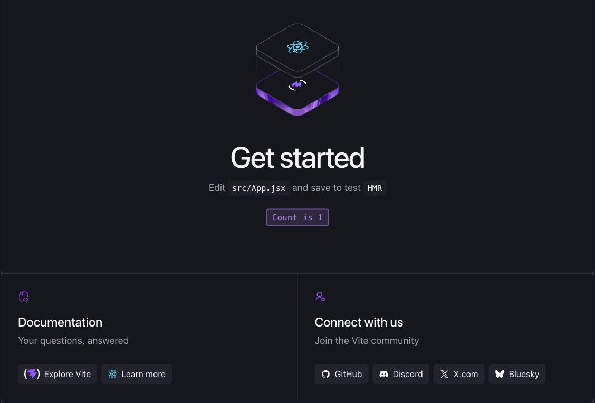

A React app on your laptop is hard to share, and manual deploy steps are easy to miss. The Celesto Python SDK lets you put those steps in one script: create a cloud computer, build the app, and publish a public HTTPS link. Teammates can open the preview without access to your laptop, and you can reuse the script for another project.

This guide uses Python to control the computer and Vite to build the React app. It requires no AI assistant or MCP client. Celesto's [public ports](https://celesto.ai/docs/cloud/features/publish-ports) support short-lived previews and development workflows; the cloud computer and app process must stay active for the link to work.



_The React starter app deployed with the script below. The counter responds to a click through the public HTTPS preview._

## Paste instruction to AI agent

```text
Deploy my app to a public Celesto Cloud preview through the
Python SDK. Use the project directory or repository I provide. If neither
is available, ask me for one. Complete the deploy and verify the result.

Use this guide for the Celesto SDK calls and computer lifecycle. Adapt
the app commands to my project's framework and runtime:
https://celesto.ai/blog/posts/platform/deploy-react-app-with-celesto-python-sdk/

1. Inspect the README, manifests, lockfiles, and deployment configuration.
   Identify the framework, runtime versions, install and build commands,
   start command, HTTP port, required environment variables, and services
   such as databases. Use the actual app and intended Git revision.
   Account for local changes; do not silently deploy an older revision.
   Ask only for required details you cannot infer from the project.

2. Check for Python 3.11 or later. Create an isolated virtual environment
   and install celesto==0.1.4. Use saved Celesto credentials or
   CELESTO_API_KEY. If neither exists, ask me to authenticate with
   celesto auth login or set CELESTO_API_KEY in the environment where
   you run the SDK. Never request or print API keys in chat.

3. Use CloudComputer with the coding-agent template and a persistent
   lifetime. Reuse this project's saved computer ID if one exists, and
   resume the computer if it is stopped. Otherwise create one and save
   its ID immediately in an untracked local file. Transfer the intended
   source revision without local secrets, dependency directories, or
   credentials. Use authorized Git access for a private repository.

4. Ask me to supply required secrets through the remote environment's
   secret store or a protected file outside the repository and served
   directories. Pass them only to the server processes that need them.
   Never expose secrets in chat, logs, frontend code, or build output.
   Use isolated preview data and keep databases and internal services
   private. Ask before any destructive migration or use of production data.

5. Install the required runtimes and dependencies on the cloud computer.
   Build the app if required, and use its production start command rather
   than a development server. For a static app, serve only its public
   assets or build output, never the repository root; add a route fallback
   only if the app needs one. For an API or server-rendered app, start its
   server. Bind the public HTTP entry point to 0.0.0.0 on an available
   port. Keep processes active after the command session ends and save
   their logs. Check every command's exit code.

6. Verify the app's HTTP response inside the computer, then publish its
   HTTP entry port with publish_port. Wait for status published and use
   the returned URL. Configure public URLs, origins, proxy routes, and
   allowed hosts for that exact preview hostname. Rebuild or restart if
   needed; browser code must not depend on localhost APIs. Check the public
   page or API and a representative user flow. For a UI, verify assets and
   route refreshes in a browser if available. Report failures, dependency
   advisories, and any checks you could not perform. Do not claim success
   from a URL alone.

7. Leave the successful preview active and close only the SDK connection.
   Return the public URL, computer ID, deployed revision, verification
   results, and exact commands to update, stop, resume, or delete it.
   The resume commands must also restart app processes and verify the
   public route; republish the port if needed.
   On failure, report the failed step and any resources left active.
```

For a React example you can deploy directly from your terminal, follow the steps below.

## 1. Install the SDK and authenticate

You need Python 3.11 or later, a [Celesto account](https://celesto.ai/sign-up) with cloud computer access, and an API key from **Settings → Security**.

In a local terminal on macOS or Linux, create a project directory and install the version used in this guide:

```shell
mkdir react-cloud-preview
cd react-cloud-preview
python3 -m venv .venv
source .venv/bin/activate
python -m pip install "celesto==0.1.4"
celesto auth login
```

Follow the prompt to save your API key locally. The SDK can also read `CELESTO_API_KEY` from the environment, which suits automated jobs with a secret store. Keep the key out of source code and frontend variables. See the [authentication guide](https://celesto.ai/docs/cloud/authentication).

Python runs on your machine. Node.js, npm, and the React build run on the Celesto computer, so you do not need Node.js locally.

## 2. Create the deploy script

Save the code below as `deploy.py`. By default, it creates a Vite React starter app. To deploy your own Vite React app, set `REPO_URL` to its public Git repository URL. That repository must have a `package-lock.json`, an `npm run build` script, and output to `dist`.

```python
from pathlib import Path
import shlex
import time

from celesto import CloudComputer


REPO_URL = ""
STATE_FILE = Path(".celesto-react-computer")
PORT = 3000

if STATE_FILE.exists():
    raise SystemExit("A computer ID is already saved. Reuse or delete it first.")

computer = CloudComputer(
    template_id="coding-agent",
    lifetime="persistent",
)


def run_checked(command: str, timeout: int = 300) -> None:
    result = computer.run(command, timeout=timeout)
    print(result.stdout, end="")
    if result.exit_code != 0:
        raise RuntimeError(
            f"Remote command failed ({result.exit_code}): {result.stderr}"
        )


try:
    computer.start()
    STATE_FILE.write_text(computer.id + "\n")
    print(f"Computer: {computer.id}")
    run_checked("node --version && npm --version")

    if REPO_URL:
        setup = (
            f"git clone -- {shlex.quote(REPO_URL)} react-app && "
            "cd react-app && npm ci"
        )
    else:
        setup = (
            "npm create vite@latest react-app -- "
            "--template react --no-interactive && "
            "cd react-app && npm install"
        )
    run_checked('cd "$HOME" && ' + setup)
    run_checked(
        'cd "$HOME/react-app" && npm run build && '
        "npm install --save-dev --save-exact serve@14.2.4"
    )
    run_checked(
        'cd "$HOME/react-app" && setsid -f sh -c '
        "'exec ./node_modules/.bin/serve -s dist -l tcp://0.0.0.0:3000 "
        '> "$HOME/react-app-server.log" 2>&1 < /dev/null\''
    )

    for _ in range(30):
        result = computer.run(
            "curl --fail --silent --max-time 2 http://127.0.0.1:3000/",
            timeout=10,
        )
        if result.exit_code == 0:
            break
        time.sleep(1)
    else:
        run_checked('tail -n 50 "$HOME/react-app-server.log"')
        raise RuntimeError("The app did not respond on port 3000.")

    route = computer.publish_port(PORT)
    for _ in range(30):
        if route.status == "published" and route.url:
            print(f"Preview: {route.url}")
            break
        if route.status == "error":
            raise RuntimeError("The public route reported an error.")
        time.sleep(2)
        route = next(
            (p for p in computer.published_ports() if p.port == PORT), route
        )
    else:
        raise RuntimeError("The public route is not ready. Inspect it later.")
finally:
    computer.close()
```

Run it from the same local directory:

```shell
python deploy.py
```

The script prints the computer ID, dependency and build output, and the public URL once its route is ready. Open the URL and confirm that the page, assets, and buttons work. If the app has a route such as `/dashboard`, open it directly and refresh it too.

The `coding-agent` template supplies Node.js and common build tools. Check the printed Node.js version against [Vite's requirements](https://vite.dev/guide/); Node.js 22.12 or later in the 22.x series meets its documented baseline. If npm reports an incompatible version, install a supported Node.js version on the saved computer before you retry the app setup.

A private repository requires Git credentials on the cloud computer before the clone. Do not place tokens in `REPO_URL`.

## 3. Understand the lifecycle

`CloudComputer` explicitly selects Celesto Cloud. `computer.start()` creates the computer, and the script saves its ID in `.celesto-react-computer` so you can return to it later. Add that file and `.venv/` to your local `.gitignore`.

`computer.run()` returns a result even when a shell command fails. The helper checks `exit_code` so a failed install or build stops the deploy script. Each call uses a separate shell, so the commands select the project directory explicitly.

Vite builds browser-ready files in `dist`. The static server exposes only that directory. Its `-s` option lets React handle client-side routes, and `0.0.0.0:3000` lets Celesto reach the app. `setsid -f` keeps the server active after the command session ends. See [Vite's deployment guide](https://vite.dev/guide/static-deploy.html) and the [`serve` reference](https://github.com/vercel/serve).

`publish_port(3000)` returns a route object with `status` and `url` fields. A URL alone does not prove that the route is ready, so the script checks its status before it prints the preview link.

`close()` releases the local SDK connection. It leaves the cloud computer and app active. The script uses an explicit persistent lifetime; an ephemeral `with CloudComputer(...)` block would delete its computer at block exit.

If a later step fails, the computer remains available for diagnosis. Reuse its saved ID instead of a fresh computer for each retry. A crash between creation and the local ID save can leave a computer without a state file; check your Celesto dashboard before another attempt.

## 4. Reconnect and inspect the app

Save this as `inspect_preview.py` beside `deploy.py`:

```python
from pathlib import Path
from celesto import CloudComputer

computer_id = Path(".celesto-react-computer").read_text().strip()
computer = CloudComputer.get(computer_id)
try:
    result = computer.run('tail -n 50 "$HOME/react-app-server.log"')
    print(result.stdout)
    if result.exit_code != 0:
        raise RuntimeError(result.stderr)
    for route in computer.published_ports():
        print(route.port, route.status, route.url)
finally:
    computer.close()
```

Run `python inspect_preview.py`. `get()` attaches to the saved computer; it does not create a replacement or resume a stopped computer.

For app updates, use the same handle to run commands in `$HOME/react-app`. Pull your source changes, install dependencies, and rebuild `dist`. Commit the `serve` dependency and lockfile changes from the first deploy before a later `npm ci`. An in-place build can briefly interrupt requests, so reserve this update flow for previews.

## 5. Stop or remove the preview

Use the saved computer ID for lifecycle actions:

| SDK call                        | Effect                                                                               |
| ------------------------------- | ------------------------------------------------------------------------------------ |
| `computer.unpublish_port(3000)` | Removes the public route but leaves the app process active.                          |
| `computer.stop()`               | Stops processes, preserves files, and suspends public ports.                         |
| `computer.resume()`             | Starts a stopped computer. Start the static server again and check the route status. |
| `computer.delete()`             | Permanently deletes the computer and its files.                                      |

To delete this preview after you save any source changes, run this from your local project directory:

```python
from pathlib import Path
from celesto import CloudComputer

state_file = Path(".celesto-react-computer")
computer = CloudComputer.get(state_file.read_text().strip())
try:
    computer.delete()
    state_file.unlink()
finally:
    computer.close()
```

The script removes the local state file only after deletion succeeds. You can then run `deploy.py` to create another preview.

Treat the preview URL as public. Add app-level authentication if the app exposes private data, and keep API secrets on a backend: any value bundled into the React app is visible to visitors.
